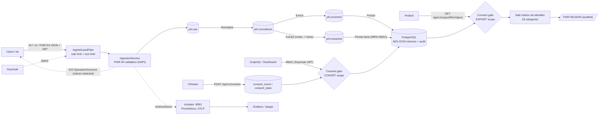

# Healthcare Data Ingestion Pipeline

[](https://github.com/Ashishk9670/healthcare-ingestion-pipeline/actions/workflows/ci.yml)
[](https://github.com/Ashishk9670/healthcare-ingestion-pipeline/actions/workflows/codeql.yml)
[](https://github.com/Ashishk9670/healthcare-ingestion-pipeline/actions/workflows/trivy.yml)
  

> **SYNTHETIC DATA ONLY.** This project is a reference/demo implementation. Never load real PHI into it.
> All sample data comes from the built-in synthetic generator (`SyntheticDataGenerator`): invented names,
> `SYN-` MRNs, SSNs from the never-issued 9xx range. No secrets are committed: dev passwords and
> encryption keys are generated locally into a git-ignored `.env`.

Spring Boot 3.5 / Java 21 / Maven. Ingests HL7 v2 and FHIR R4 JSON (validated with HAPI FHIR), runs it through
Kafka stages (normalize, enrich, persist, plus clinical-note extraction), stores it encrypted in PostgreSQL and serves
aggregated patient/cohort views over GraphQL. Cohorts and bulk exports respect per-patient consent; exports are
Safe Harbor de-identified and audited. Also: audit logging, RBAC (Keycloak) and PHI-masked logs.

Design decisions are recorded in [`docs/adr/`](docs/adr/).

## Architecture



Plain-text view:

```
 HL7 v2 / FHIR JSON                    +-------------------------------------------+
 POST /api/v1/ingest/{hl7,fhir}  --->  | IngestionService: validate, audit, send   |
 (role INGESTOR, JWT)                  +---------------------+---------------------+
                                                             v
                                                       [ phi.raw ]            RawMessage envelope
                                                             v  PipelineStages.onRaw  (Hl7V2Parser / FhirJsonNormalizer)
                                                    [ phi.normalized ]        canonical patient/observation/diagnosis
                                                             v  PipelineStages.onNormalized (EnrichmentService)
                                                     [ phi.enriched ]         + age band, code displays
                                                             v  PipelineStages.onEnriched (PatientStoreService)
                                          PostgreSQL (Flyway, JPA): AES-GCM encrypted PHI columns, audit_entry
                                                             ^
 GraphQL  POST /graphql  (CLINICIAN | ANALYST | AUDITOR) ----+   every access -> audit_entry
 Dashboard UI  GET /  (Keycloak login, auth code + PKCE)
```

| Concern | Implementation |
|---|---|
| Ingestion | `api/IngestController`, `api/IngestionService` (also `POST /api/v1/synthetic?count=N` to generate + ingest fake patients) |
| Kafka stages | `kafka/PipelineStages` (3 `@KafkaListener`s), topics `phi.raw`, `phi.normalized`, `phi.enriched`, `phi.extracted` |
| FHIR R4 validation | `fhir/FhirR4Validator` (HAPI FHIR profile validation); invalid bundles get `422` + a FHIR `OperationOutcome` with severity, issue type and element path only (quoted values redacted). See ADR 0001 |
| Clinical-note extraction | `extract/*`: `ExtractionStage` consumes `phi.normalized`, runs a pluggable `Extractor` (default `RuleBasedExtractor`: ICD-10 diagnoses, medications with negation handling, cancer stage) and publishes `ExtractionEvent`s to `phi.extracted`; facts are persisted keyed by MRN HMAC (`clinical_extraction`, Flyway V2). Note text is never stored or logged. GraphQL `CohortFilter` gains `extractedDiagnosis`, `medication`, `stage` |
| De-identification | `deid/SafeHarborDeidentifier`: all 18 HIPAA Safe Harbor categories (45 CFR 164.514(b)(2)(i)) for FHIR resources and free text; see ADR 0002 |
| Export | `export/ExportController`: `GET /api/v1/export/fhir/ndjson?limit=N` (role ANALYST) streams de-identified Patient/Condition/Observation resources as NDJSON; `EXPORT_FHIR_NDJSON_START/DONE` audit entries written before and after the stream |
| Consent | `consent/*`: `POST /api/v1/consent` (role CLINICIAN) records GRANTED/WITHDRAWN per patient and scope (`COHORT`, `EXPORT`) in an append-only `consent_event` log plus effective `consent_state` (Flyway V3). Cohort queries and exports join against it; `app.consent.default-policy` = `OPT_OUT` (default, no record means included) or `REQUIRE_EXPLICIT`. See ADR 0003 |
| Parsing | `parse/Hl7V2Parser` (MSH/PID/OBX/DG1), `parse/FhirJsonNormalizer` (Bundle: Patient/Observation/Condition) |
| Enrichment | `enrich/EnrichmentService`: age band (`0-17 ... 80+`), ICD-10/LOINC display lookup |
| Storage | `store/*`, `db/migration/V1__init.sql` (Flyway) |
| Field encryption | `crypto/AesGcmFieldCipher` + JPA `EncryptedStringConverter`; MRN lookup via keyed HMAC (`mrn_hash`) |
| Audit | `audit/AuditService` persists an entry for every ingest, pipeline persist, patient view, cohort query and audit-log read (no PHI in entries; MRNs are HMACed) |
| RBAC | `security/SecurityConfig`: OAuth2 resource server, Keycloak `realm_access.roles` -> `ROLE_*` |
| Log masking | `logging/PhiMasker`, logback converters registered in `logback-spring.xml` |
| GraphQL | `graphql/PatientGraphQlController`, `resources/graphql/schema.graphqls` |
| UI | `resources/static/*` (vanilla JS dashboard) |

### Roles

| Role | REST ingest + synthetic | `patient(mrn)` | `cohort(...)` (de-identified, consent-gated) | `auditLog` | NDJSON export | record consent |
|---|:-:|:-:|:-:|:-:|:-:|:-:|
| INGESTOR | yes | no | no | no | no | no |
| CLINICIAN | no | yes | yes | no | no | yes |
| ANALYST | no | no | yes | no | yes | no |
| AUDITOR | no | no | no | yes | no | no |

Dev users (realm `healthcare`, see `docker/keycloak/healthcare-realm.json`): `ingestor1`, `clinician1`,
`analyst1`, `auditor1`; passwords are random per machine (generated into `.env`, see "Secrets and keys"). Client `pipeline-client` (public; auth code + PKCE, and
password grant for tests/scripts).

### Compliance notes / limits
- Sensitive columns (MRN, names, DOB, SSN, free-text observation values) are AES-256-GCM encrypted
  (`<keyId>:base64(iv || ciphertext || tag)`). Keys come from the environment only (no built-in defaults; the app
  refuses to start without them). Use a KMS/secret manager for anything beyond a demo.
- Key rotation: `PHI_ENCRYPTION_KEYS="k1:<b64>,k2:<b64>"`, `PHI_ACTIVE_KEY_ID=k2`. New writes use the active key, old
  rows stay readable with their key id (un-prefixed legacy values are read as `k1`). Remove an old key only after
  re-encrypting its rows (`AesGcmFieldCipher.needsRotation`).
- Ingestion limits (`app.ingest.*`): max payload 1 MiB (413), per-user token-bucket rate limit (429 + `Retry-After`),
  synthetic count cap.
- Diagnosis codes, age band, gender and numeric observation values are stored in clear to enable cohort queries.
- Kafka payloads carry PHI in clear JSON; production would need TLS + encryption/ACLs on the brokers.
- Logs: all messages and exception text pass through `PhiMasker` (SSN pattern, name/DOB/MRN key-value pairs,
  HL7 `PID|` segments, `MRN-`/`SYN-` tokens). Payloads are never logged deliberately. Masking is best-effort.
- Secrets: nothing committed; keys and passwords come from env / secret manager (`.env` locally, Kubernetes Secret in
  `deploy/k8s`). Container runs as non-root with a read-only root filesystem; actuator is on a non-public port.
- Observability is PHI-safe by construction: metric tags are fixed enums and span attributes are masked.
- Supply chain: Dependabot, CodeQL, Trivy (repo + image), JaCoCo threshold, Spotless.
- Not covered here (needed for real PHI): TLS everywhere, Kafka/DB encryption at rest and ACLs, KMS-managed keys with
  automated re-encryption, BAAs, retention/disposal policies, formal risk assessment.
- This is not a certified HIPAA implementation.

## Run it

Prereqs: JDK 21+, Maven 3.9+, Docker.

### Secrets and keys (local setup)

Nothing secret is committed. Generate random dev secrets once (writes a git-ignored `.env`: DB and Keycloak admin
passwords, the four realm user passwords `HDIP_PW_<USER>`, AES key ring and HMAC key):

```bash
scripts/gen-dev-env.sh              # or: make env
set -a; source .env; set +a         # export into your shell (compose reads .env on its own)
```

```bash
docker compose up -d --wait         # Postgres :5432, Kafka :9092, Keycloak :8180 (realm auto-imported)
mvn spring-boot:run                 # app on :8080, actuator on :8081 (Flyway migrates the DB, topics are auto-created)
```

Get a token and ingest synthetic data:

```bash
TOKEN=$(curl -s -d grant_type=password -d client_id=pipeline-client -d username=ingestor1 -d password=$HDIP_PW_INGESTOR1 \
  http://localhost:8180/realms/healthcare/protocol/openid-connect/token | jq -r .access_token)

curl -X POST -H "Authorization: Bearer $TOKEN" "localhost:8080/api/v1/synthetic?count=25"       # generator
curl -X POST -H "Authorization: Bearer $TOKEN" -H 'Content-Type: text/plain' --data-binary @sample.hl7 localhost:8080/api/v1/ingest/hl7
curl -X POST -H "Authorization: Bearer $TOKEN" -H 'Content-Type: application/json' -d @bundle.json localhost:8080/api/v1/ingest/fhir
```

Query as `clinician1` / `analyst1` (GraphQL):

```bash
curl -s -H "Authorization: Bearer $CLIN_TOKEN" -H 'Content-Type: application/json' localhost:8080/graphql -d '{
  "query":"{ cohort(filter:{diagnosisCode:\"E11\", ageBand:\"50-64\"}){ totalPatients byAgeBand{key count} byDiagnosis{key count} } }"}'
```

Record consent (`clinician1`) and export a de-identified, consent-filtered FHIR NDJSON file (`analyst1`):

```bash
curl -X POST -H "Authorization: Bearer $CLIN_TOKEN" -H 'Content-Type: application/json' localhost:8080/api/v1/consent \
  -d '{"mrn":"SYN-123456","scope":"EXPORT","status":"WITHDRAWN"}'          # scope: COHORT | EXPORT; status: GRANTED | WITHDRAWN
curl -H "Authorization: Bearer $ANALYST_TOKEN" "localhost:8080/api/v1/export/fhir/ndjson?limit=500" -o export.ndjson
```

An invalid FHIR bundle posted to `/api/v1/ingest/fhir` returns `422` with `application/fhir+json` `OperationOutcome`.

Or open http://localhost:8080/ and sign in (cohort dashboard; panels depend on role).

## Observability and container

- Actuator runs on a separate management port (`MANAGEMENT_PORT`, default 8081; keep it off public networks):
  `/actuator/health/{liveness,readiness}`, `/actuator/prometheus`. Custom metrics: `hdip_ingest_messages_total{format}`,
  `hdip_ingest_rejected_total{reason}`, `hdip_pipeline_messages_total{stage,outcome}`,
  `hdip_pipeline_stage_duration_seconds{stage,outcome}`. Tags are fixed enums only; no PHI, ids or user names.
- Tracing (OpenTelemetry, OTLP/HTTP) is off by default: set `OTEL_TRACING_SAMPLING=0.1` and
  `OTEL_EXPORTER_OTLP_TRACES_ENDPOINT`. A `PhiSafeObservationFilter` masks PHI-looking values in span attributes.
- `docker compose --profile observability up -d` adds Prometheus :9090, Grafana :3000 (admin password
  `GRAFANA_ADMIN_PASSWORD` from `.env`, provisioned dashboard "HDIP pipeline") and Jaeger :16686.
- `docker compose --profile app --profile monitoring up -d --build` adds Loki :3100 (logs), Tempo :3200 (traces), Alloy (ships only
  the app container's stdout, which is already PHI-masked, through a second redaction stage; `LogShippingPhiRedactionTest` proves
  both layers) plus Prometheus and Grafana with Loki/Tempo datasources. SLO alert rules live in `monitoring/alerts/`
  (stage latency, stage error rate and budget burn, consumer lag, app down; `promtool test rules` in CI), with runbooks in
  `docs/runbooks/`. For traces set `OTEL_TRACING_SAMPLING=0.1` and `OTEL_EXPORTER_OTLP_TRACES_ENDPOINT=http://tempo:4318/v1/traces`.
- `docker compose --profile app up -d --build` runs the app itself from the multi-stage, non-root `Dockerfile`.

## Kubernetes and releases

- `deploy/k8s/` holds hardened manifests (kustomize); CI validates them with kubeconform. See `deploy/k8s/README.md`.
- `deploy/helm/hdip` is a Helm chart with the same hardening (see `deploy/helm/README.md`): External Secrets / Sealed Secrets examples
  (placeholders only) and an Argo CD `Application` in `deploy/argocd/`. CI runs `helm lint` and `helm template | kubeconform`.
- Pushing a tag `vX.Y.Z` runs `.github/workflows/release.yml` and publishes `ghcr.io/ashishk9670/healthcare-ingestion-pipeline`.
- Load test: `loadtest/` (k6).

## Tests

| Layer | What | Command | Needs Docker |
|---|---|---|:-:|
| Unit | HL7/FHIR parsing, FHIR R4 validation, masking, AES-GCM, enrichment, note extraction, Safe Harbor de-identification (one case per category), consent decisions, NDJSON export, synthetic generator, Kafka stage wiring (Mockito), ingestion service, store service, role converter, REST security with mock JWT (`@WebMvcTest`), GraphQL RBAC (`@GraphQlTest`) | `mvn test` (or `make test`) | no |
| Property-based | jqwik (`*PropertyTest`): HL7 parser never throws anything but `MessageParseException` and round-trips PID fields; masked logs never contain generated SSN/MRN/DOB; Safe Harbor output (free text and FHIR bundles) contains no generated identifier from any category; AES-GCM round trip, tamper detection, wrong key and key rotation | `mvn test` | no |
| Architecture | ArchUnit (`arch/ArchitectureTest`): package boundaries (model/crypto/deid/logging/parse are leaf layers), no controller to repository access, no PHI entities in controllers, no `System.out`/`java.util.logging`, methods that log must not read PHI accessors | `mvn test` | no |
| Coverage | JaCoCo report in `target/site/jacoco/index.html` (unit) and `jacoco-it` (integration) | `mvn verify -DskipITs` / `mvn verify` | no / yes |
| Integration + API | `*IT` classes (Failsafe) with Testcontainers Postgres, Kafka and Keycloak (same realm export): full pipeline REST->Kafka->Postgres, encrypted-at-rest check, REST + GraphQL role matrix with real Keycloak JWTs, audit-log assertions | `mvn verify` (or `make it`) | yes |
| E2E UI | Playwright (`e2e/`): Keycloak login, per-role panels, cohort filters, audit view, synthetic ingest | `make up && make run`, then `make e2e` (first `make e2e-install`); or `make e2e-local` / `scripts/e2e.sh` for all-in-one | yes |

CI (`.github/workflows/ci.yml`): build + unit + JaCoCo, then integration tests, then docker-compose + Playwright e2e
with the HTML report uploaded as an artifact.

Note: the unit tests set `-Dnet.bytebuddy.experimental=true` so Mockito works on newer JDKs than the one it was built for.

## Layout

```
docker-compose.yml, docker/keycloak/healthcare-realm.json
src/main/java/com/example/hdip/{api,audit,config,consent,crypto,deid,enrich,export,extract,fhir,graphql,kafka,logging,model,parse,security,store,synthetic}
src/main/resources/{application.yml,logback-spring.xml,db/migration,graphql,static}
src/test/java/...            unit (*Test), property (*PropertyTest), architecture and Testcontainers integration tests (it/*IT)
docs/adr/                    architecture decision records
e2e/                         Playwright tests
```
